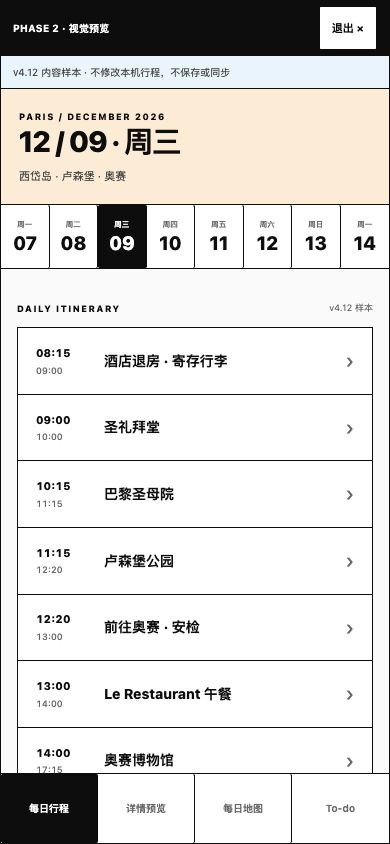
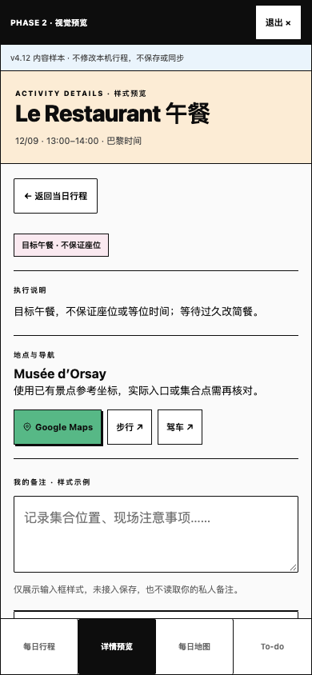
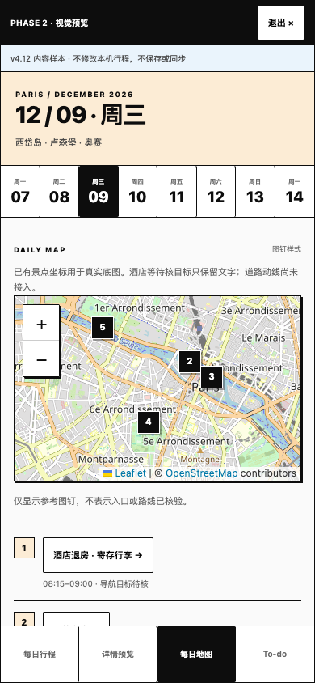
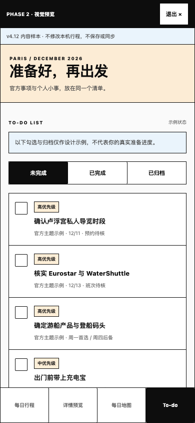

# Paris Pocket — Phase 2 Visual Review

2026-11-09。状态：**整体视觉已获原则认可，完成指定小幅收尾后等待最终 Phase 2 评审。** 分支 `feature/paris-pocket-v2-refactor`，继续使用草稿 PR #2。Phase 1 已批准；本轮不开始 Phase 3、不合并 main、不生产部署。

## 预览方式与四屏截图

本地 `npm start` 后打开 http://localhost:4173 ，点击页头 **「v4.12 预览」**。本轮运行的本地检查地址为 http://localhost:4178 。可以切换 8 个日期和 4 个设计评审页面；退出后返回原本可用的行程/地图/预约/旅行卡片。

下面是 **390×844 CSS px、1× 像素**的实际浏览器截图，没有拼接或绘制假地图。黑条和蓝色说明明确标注视觉样本；预览不会改写本机行程、个人记录或预约状态。

| 每日行程（v4.12 周三样本） | 活动详情（目标午餐，非预约确认） |
| --- | --- |
|  |  |

| 每日地图（真实底图 + 已有参考坐标） | To-do（明确标识的只读状态样例） |
| --- | --- |
|  |  |

主界面的真实旧数据也应用相同视觉，并保留全部管理入口：[现有行程截图](screenshots/existing-itinerary-390.png)。列表只显示时间与名称，点击真实详情可编辑、上移/下移、查看关联预约或跳到当日笔记；删除/恢复与添加仍沿用现有功能。

## 已改变的视觉与交互

- 依 UI Reference Package v1.1：淡桃/粉/蓝/薄荷色、1px 近黑边框、方形卡片、克制硬边阴影、粗细分明的字重、绿色主要操作。保留手机底部导航、日期切换和 safe-area，未移植桌面侧栏或 PM 业务。
- 现有每日列表收简为时间与名称；**时间列和名称之间没有竖线**，只有横向行分隔。完整描述、导航、预约入口、编辑及排序移到同一真实详情弹窗，现有功能未删除。
- v4.12 仅作为隔离的视觉样本，涵盖八日主题/行李转场、周三奥赛午餐、周五 Louvre 待核等。未覆盖 trip-data.js，不产生新 official snapshot 或身份映射。
- 预览 Activity Detail 的独立备注只读，明确写「未接入保存」；To-do 的示例勾选/创建禁用且清楚标注，未完成/完成/归档筛选只切换样例，未伪装持久化。没有可冒充真实同步的按钮。
- 地图保持真实 Leaflet/OSM 底图，展示已有景点参考坐标；酒店/未知入口仅列文字。未新增未经核验路径、假道路/预计 ETA，也未接入付费 API。
- 新预览 JS 加入完整 shell 缓存，CACHE_VERSION 改为 paris-pocket-v5-phase2-review；延续用户手动更新策略。Manifest 只改视觉背景/theme 色，安装 id/start_url/scope/图标保持原样。

## 本轮评审收尾

- 保留已获原则认可的淡色 Neo-Brutalist 视觉和无竖线每日列表；没有再次重设计或新增产品功能。
- 实际主导航仍为行程、地图、预约、旅行卡片；不存在独立 Activity Detail tab。隔离预览的「详情预览」仅供四屏评审，不能复制为最终产品导航。最终按 PRD 从行程或地图打开详情；真实主地图的进一步集成仍属于后续阶段，不在本次追加。
- PHASE 2 横幅只在隔离预览中，主应用没有阶段/debug 横幅。最终集成时移除阶段标识及评审入口；当前旧内容来源提示保留，避免把旧行程误认为 v4.12。
- 英文标题保持 `Paris, at our pace`，微调字距与词间距，让逗号后的空格清楚可见；未改变字体系统或布局。
- 本次公开推送明确包括已完成的 Phase 2 代码、390px 四屏截图、测试结果与这些评审说明，继续使用原分支及草稿 PR #2；不合并 main。

## 数据保护与范围证据

`trip-data.js`、`personal-data.js`、`itinerary-data.js`、`map-links.js` 与 Phase 1 提交相同；没有更改 storage key、schema、备份格式或现有 canonical 活动 ID。没有 IndexedDB、迁移或官方同步实现。

自动化在隔离 Chrome profile 使用模拟资料，验证预览前后原 `paris-pocket-personal-v1` 字符串逐字一致，Storage.setItem 调用为 0、IndexedDB.open 为 0，现有预约勾选/笔记仍可达。真实编辑/笔记操作继续按原逻辑保存，仅由用户动作触发；没有读取或改动生产浏览器资料。

`visual-preview.js` 只读样本不会进入个人备份。预览资源初次加载失败时隐藏该可选入口，真实行程与编辑器仍能工作；地图引擎失败后允许重试。实际主界面标明为原有行程/记录，避免把旧「酒店未定」和旧安排误认成 v4.12。

## 验证结果

| 检查 | 结果 |
| --- | --- |
| npm test | 20/20 通过，原个人数据/活动管理/Google URL 纯测试保留 |
| test:browser | 通过；真实详情→编辑、XSS、笔记/预约、备份往返、quota/损坏存储、离线、320–1024px；补充详情关闭/跳笔记的正确焦点和零写入 |
| test:management | 通过；新增/编辑/跨日/排序/删除恢复、稳定 ID、预约备注保留、完整/旧备份、离线与旧窗口冲突 |
| test:pwa | 通过；手动更新、编辑草稿保护、原 storage 保留、自家缓存清理、完整离线 shell、不完整安装保留旧 shell |
| test:visual | 通过；4 屏×320/375/390/430px，0 横向溢出、导航在 844px 内、无竖线、详情无独立主导航项、阶段横幅隔离、预览零持久化/零 DB、待核状态、可选预览失败后编辑仍可用 |
| 源/文档检查 | JS syntax、diff whitespace、文档链接通过；旧数据/存储模块逐字对比无变化 |

本轮新增截图与 [布局结果](screenshots/layout-checks.json) 可由下列命令重新生成。320/375/430px 附加截图写入忽略目录 `test-results/phase-2/`，主评审截图保存在本目录。

```sh
npm ci
npx playwright install chromium
PORT=4178 npm start
# 另一个终端；没有 Chrome 时省略 PW_CHANNEL 使用已安装 Chromium
npm test
TEST_URL=http://localhost:4178 PW_CHANNEL=chrome npm run test:browser
TEST_URL=http://localhost:4178 PW_CHANNEL=chrome npm run test:management
PW_CHANNEL=chrome npm run test:pwa
TEST_URL=http://localhost:4178 PW_CHANNEL=chrome npm run test:visual
```

## 改动文件

| 文件 | 目的 |
| --- | --- |
| styles.css | 可复用色彩/边框/字体/阴影 token，以及全部现有页面、编辑器、详情和设计预览的移动样式 |
| index.html | 可选预览入口、旧内容来源标签、真实详情/隔离预览 dialog、新脚本 |
| app.js | 简洁列表与真实详情；保留原编辑、排序、预约与笔记跳转；焦点恢复；预览可选初始化与 Leaflet 失败重试 |
| visual-preview.js | 不读写个人存储的八日 v4.12 样本、四屏展示与真实参考图钉 |
| manifest.webmanifest / sw.js | 视觉 theme 色、缓存版本及新本地脚本；不改安装身份或缓存策略 |
| tests/browser.cjs / management.cjs / pwa.cjs | 适配从真实详情进入旧编辑器，保留原行为断言与失败保护 |
| tests/visual.cjs / package.json | 新增 mock 隔离、布局、失败降级检查与可重现截图命令 |
| AGENTS / PRODUCT_BRIEF / CODEX_START_HERE / README / 中文说明 | 记录本轮批准及边界，明确在迁移验证前保留编辑器；等待视觉评审 |
| docs/phase-2/ | 本轮结果、截图与布局证据 |

## 已知限制与停止条件

- 此阶段不是新数据集成。主界面保留旧行程/预约及个人数据；v4.12 是标注样本，不代表新行程已同步。独立备注、统一 To-do、本机任务及云端同步均未实现。
- 预览地图不是最终 Stop/Segment 模型：相同景点用已有参考图钉，同酒店早晚访问保留在文字清单；没有承诺完整真实动线。经核验入口/酒店坐标、道路轨迹、路线许可属于后续工作。
- 已装/未装 Google Maps 的 iPhone handoff、Safari/主屏幕真实安装、键盘/VoiceOver、动态字体与真实旧安装升级仍未真机验收。当前为 Chromium 手机尺寸模拟。
- PWA 测试仍使用旧 worker fixture + 当前 HTML/JS，未宣称覆盖真实旧 bundle→新 schema。系统字体作中文/拉丁 fallback，未引入额外远程字体依赖。
- 行程源 DATA-01…05 保持待核；周一/周四游船不变成两次已订项目，周五 Louvre 不擅自挑选冲突时段。

**到此停止，等用户视觉批准后再讨论 Phase 3。** 架构方向虽获认可，实施较复杂 IDB 同步与回滚前仍需核实它是否是这款两人旅行 App 最简单可靠的方案。没有 main 合并或生产发布授权。
