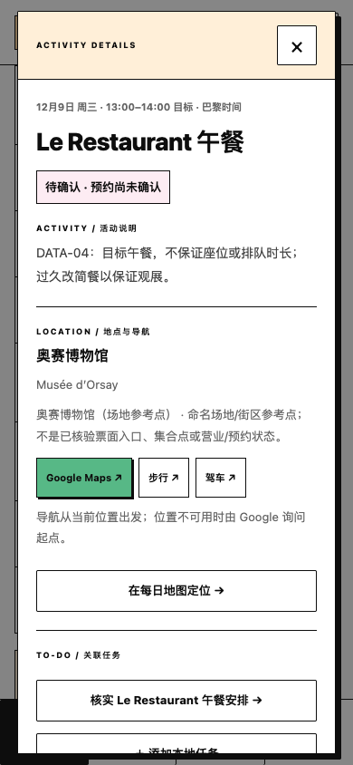
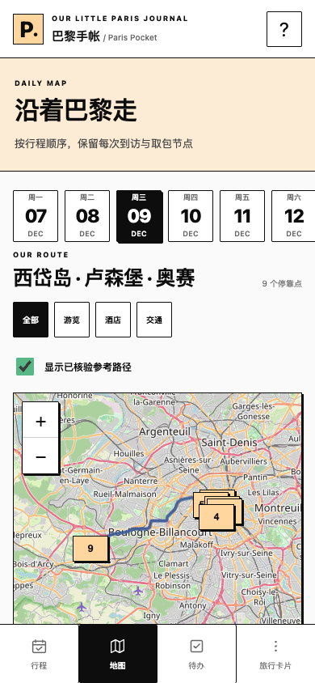
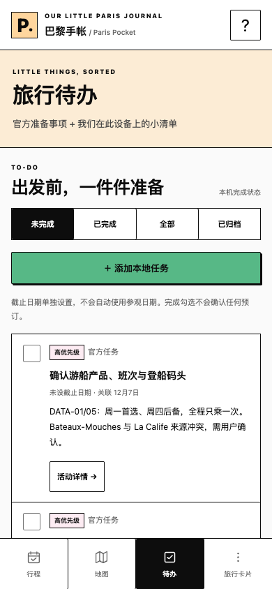

# Paris Pocket — Phase 3 功能评审包

> 第一轮历史交付。最新地图分类、发布保留修复及 PR/真机准备见 [首轮反馈收尾](REVIEW_FOLLOWUP.md)，当前 Node 检查为58项。此处的36项/八套浏览器结果保留为 fe21176 的运行证据。

2026-11-09。用户已批准开始 Phase 3。所有工作位于 `feature/paris-pocket-v2-refactor` / [现有草稿 PR #2](https://github.com/jayven/Paris--traveler-note/pull/2)，保留 Phase 2 已认可视觉。**未合并 main、未部署生产、未更改 Netlify 设置、未访问或迁移真实生产个人资料。**

本轮完成可测试的功能整合候选；地图全路径覆盖和真实 iPhone 验收仍有门槛，因此不宣称全部 P0 完成或可直接生产发布。

## 已实现

- v4.12.1 单个官方快照：八天、62 活动、48 Place、76 Stop、68 Segment、14 官方任务、五家已确认酒店。官方按 order 只读；未确认游船、私人导览时段、车船、约拍与午餐仍保持待核。
- 行程/地图共用活动详情，本机活动备注自动保存、离线重载。详情只从活动进入，没有独立底部 tab。时间与名称间没有竖线，保留横向分隔。
- 官方与本地 To-do；本地增删改、完成勾选、优先级、独立截止日、链接/备注/活动和日期关联。逾期先按截止日，其余按优先级/截止日排序；各设备状态独立。
- 小型原生 IDB：官方与个人记录分开；完整旧 raw/context 档案、revision 冲突保护、失败草稿保留。旧编辑器、预约和全部笔记仍能在 legacy.html 查看与编辑。
- 官方打开检查/手动同步、SHA256/字节/版本/引用/业务规则校验、事务提交、previous 回退与坏版本隔离；个人资料不随官方回退删除。
- v2 完整备份，v1 导入保留为旧档案；预览/确认、导入前检查点和可撤销导入。有未保存草稿时阻止完整导入/导出，支持单独导出草稿；存储失败仍能尝试导出旧键原文。
- Leaflet 底图、类型筛选、真实道路几何显示/隐藏、重复到访列表、地图/详情定位，以及默认 Google Maps 当前位置/明确单段起终点的步行和驾车 URL。无付费 API、无密钥、无实时自研导航。
- SW 完整 shell + 校验 bootstrap，独立数据请求绕过 shell 缓存；手动 App 更新保护表单。发布目录白名单构建只准备 dist，不部署。

[实施决策与维护契约](IMPLEMENTATION.md) 说明为什么采用一个 IDB store、一个官方快照和有限回退，而没有引入泛用同步框架。[地图来源/许可/覆盖](MAP_SOURCES.md) 记录地点语义、供应商条件和精确缺口。

## 手机截图

均为 390×844 CSS px，Chrome iPhone 参数、独立空资料 profile，使用真实 v4.12 官方内容；不是 Safari 真机。

| 每日行程 | 活动详情 |
| --- | --- |
|  |  |
| 每日地图 | To-do |
|  |  |

另有 [GHPR 早存晚取同坐标的重复访问](screenshots/daily-map-revisit-390.png)。[布局报告](screenshots/layout-checks.json)：320/375/390/430px × 四屏，无页面水平溢出，无时间列竖线，输入 16px、主要触控≥44px、详情无底部独立 tab。底图初次或离线失败时使用列表/Google 链接降级，不伪造路线。

## 实际测试结果

所有资料均为合成测试数据；不读取生产 localStorage，不提交真实用户备份。Node / 已安装 Chrome headless + Playwright；测试通过后没有清除生产站点资料。

| 命令 | 结果与范围 |
| --- | --- |
| npm test | **36/36 PASS**：旧 personal/itinerary/地图 URL、官方 schema/业务、迁移/备份纯校验、公开产物白名单 |
| test:browser | PASS：保留旧编辑器、笔记/预约、导入导出、失败保护、离线、320–1024px |
| test:management | PASS：旧活动增删改/移动/排序/恢复、备份、预约关联、多窗口冲突 |
| test:visual | PASS：历史隔离预览四屏/四宽，零旧存储写入与 IDB 打开；输出 test-results，不覆盖已批准 Phase 2 截图 |
| test:store | **8 组 PASS**：真实 IDB 事务、原文/上下文读回、未知旧 schema、中断/容量失败、多窗口、同步时编辑、错误数据/哈希/序号、显式归档与退役、回退隔离、导入撤销 |
| test:integrated | **6 组 PASS**：新版备注/任务/备份完整 UI、旧数据隔离、离线、道路开关/筛选/重复 Stop/共享详情、四屏布局，零页面错误 |
| test:concurrency | PASS：两个新版标签页陈旧备注/任务不可借后台刷新或同步覆盖对方；失败草稿保留/导出，导入导出保护 |
| test:pwa | **5 组 PASS**：真实 main `0579040` HTML/JS/data/SW → 新 shell 等待更新/草稿保护；旧窗口后续写入；离线新版及旧编辑器；缺核心资源拒绝安装；旧→新→旧→新；空 IDB 离线 bootstrap |
| test:failure | **4 组 PASS**：读存储失败不建空库、IDB 失败/首次容量失败只读及原文恢复、非法旧资料写保护、备注写失败保留草稿/导出/真实重试 |
| build:site / git diff --check | PASS：准备 22 个公开文件，无部署；源码/文档无空白错误 |

复现环境与命令见根 [README](../../README.md)。PWA 测试旧 bundle 直接读取 Git 固定提交，已替换之前“只换旧 worker、仍用当前 HTML/JS”的不充分 fixture。

## 变更文件

- 主产品：`index.html`、`app.js`、新增 `views.js`，`styles.css` 仅增加沿用 token 的功能布局与时间换行修正。
- 模型/存储：新增 `official-data.js`、`local-store.js`；未改旧 `trip-data.js`、`personal-data.js`、`itinerary-data.js` 数据契约。
- 兼容入口：新增 `legacy.html`、`legacy-app.js`，保留原功能与独立历史视觉预览。
- 数据/准备：新增 `trip/` 官方维护源、核验记录、manifest/bootstrap/hash 快照，`scripts/build-trip.cjs`、`scripts/generate-routes.cjs`、`scripts/build-site.cjs`。
- 离线/导航：`sw.js`、`map-links.js`、本地 server JSON MIME；manifest 安装身份和图标未变。
- 验证/文档：新增官方/存储/整合/并发/失败/发布测试，旧回归入口指向 legacy；更新 package/lock、AGENTS、PRODUCT_BRIEF、README 和本评审包。Phase 1/2 文档保留历史定位并链接当前实现。

## 尚未完成与人工门槛

1. **真实动线 P0 尚未全覆盖。** 28/68 段有核验道路几何。其余40段包含铁路/水路、同场地、未定方式及未核实起终点。不得用直线或驾车填补。需先确认游船产品/码头、Louvre 导览时段/集合点、鹿特丹交通、约拍、CDG 航站楼等，再完善合法道路段。详见地图来源表。
2. Chrome 手机模拟未验证真实 Safari/主屏幕、软键盘/VoiceOver、低容量系统回收、Google Maps 已装/未装与定位拒绝。浏览器系统强制关闭时内存草稿可能丢失，保存失败应及时导出。
3. 目前只支持官方 schema 1 / personal schema 4，未知版本拒绝，不写未知结构。未来真正跨 schema 发布前须另做旧客户端兼容快照保留与连续两次新版发布测试，不能声称当前已实现泛用多 schema 回滚。
4. 未启用账号、云后端或双人个人资料同步。官方内容相同不代表两机勾选/笔记相同。
5. dist 白名单已经可构建，但未更改现有 Netlify 发布目录/构建设置；Deploy Preview 是否已为此仓库启用仍需核验。main webhook 可能立即触发生产，不能合并试验。

## iPhone 验证方法（发布前）

使用同一现有 Netlify site 的独立 HTTPS Deploy Preview（取得 URL 后），不要用生产记录做破坏性测试，不要清空正式网站数据。普通电脑 LAN HTTP 缺少 WebCrypto/SW，不能代替 HTTPS 功能验收。

1. Safari 打开预览，点 12/9：检查 GHPR 早寄存/晚取包、奥赛与 Waldorf；点活动读待核状态，输入备注，关闭、重开、刷新。
2. 在待办添加本地任务，选择优先级/独立截止日/链接和关联，修改、勾选、切换未完成/已完成；确认不改变官方预约状态。
3. 地图切酒店筛选/隐藏路径；同坐标 GHPR 可分别打开两次到访详情。点 Google Maps 查看/步行/驾车，分别测已安装/未安装 App 与拒绝当前位置。
4. 导出合成备份，导入先取消，再确认并撤销；旧记录页和原文导出可达。不要把私人备份上传 GitHub 或聊天。
5. 在线完整载入并添加主屏幕后，飞行模式冷启动：文字、备注、任务可用；底图缺失有提示。恢复网络，手动同步失败应保留现有内容；App 更新等待点击且表单未保存时不强制更新。
6. 在两个预览窗口同时编辑同一备注/任务，验证旧表单报冲突并保留草稿。真实旧安装升级演练用合成资料的隔离环境，不清生产数据。

完成事实核实、HTTPS 真机验收和本轮功能评审后，再单独申请 main 合并及生产部署批准。
