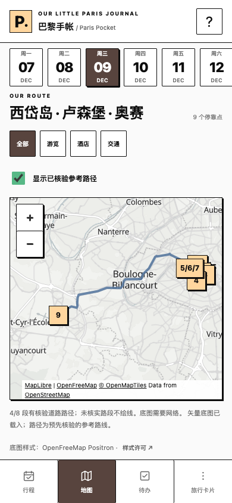
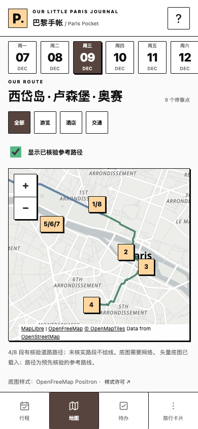

# Paris Pocket — HTTPS 预览验收

2026-11-09（Pacific）。现有视觉已批准并冻结：`#58443E` 棕色选中态、MapLibre GL JS 6.17.0 + OpenFreeMap Positron。保持原功能分支及草稿 PR #2；本次只做用户明确授权的隔离预览，未合并 main、未部署生产、未改 Netlify 共享/生产设置或生产个人资料。

## 实际预览

| 项目 | 值 |
| --- | --- |
| HTTPS 测试 URL | **[打开 Paris Pocket 测试预览](https://feature-paris-pocket-v2-refactor--stirring-cheesecake-37698e.netlify.app/)** |
| 部署源 SHA | **`6ab27623d4d7d6888c25d8846524e7c68ed57ee5`**（批准的 `6ab2762`） |
| Deploy ID / 状态 | `6af2bf7c9b1e9384dabc6255` / `ready` |
| Netlify context | `deploy-preview`；手动 draft，非生产 |
| 来源 Git 分支 | `feature/paris-pocket-v2-refactor`，现有草稿 [PR #2](https://github.com/jayven/Paris--traveler-note/pull/2) |
| Netlify URL 分支标签 | Netlify 将标签规范化为 `feature-paris-pocket-v2-refactor`；未新建或重命名 Git 分支 |
| 部署创建时间 | `2026-11-10T06:53:48.284Z` |
| 现有 site | `stirring-cheesecake-37698e` / `7998275f-56b4-4599-80ef-d05a772a00e1`；没有新建站点 |
| 生产保持 | `main` / `05790404b87b616db7b1a786770232dc55fbfe7b`，发布 ID `6acdda4772ee0e568f484bcb` |

不是旧 `deploy-preview-2` 地址；旧 PR 自动预览仍为 fe21176。请整个验收过程固定使用上表 URL，以免在不同 origin 混淆备注／任务／安装。用户已确认能在自己的浏览器看到该预览。

本次使用官方 CLI OAuth 登录后的 Netlify API，把验证后的 **dist 文件 digest** 上传为 `draft:true`，没有上传仓库根目录、引入 netlify.toml、修改共享 build/publish、解除自动发布锁或使用生产发布开关。Deploy 的 `commit_ref` 已核对为上表 SHA；部署前后生产发布 ID、SHA 和共享 build/publish/base/production branch 完全一致。[部署收据与上传清单](deployment.json)。API draft 机制见 [Netlify 官方说明](https://docs.netlify.com/api-and-cli-guides/api-guides/get-started-with-api/#draft-deploys)。

本次部署之后的提交仅保存验收文档／测试，不包含额外产品修改，也没有再次部署。PR 与提交保留 `[skip netlify]`；后续预览或生产发布需要另批。

## 已核验与待验边界

| 检查 | 本次证据 |
| --- | --- |
| 公共产物白名单 | `check:releases`、`build:site` PASS：**23 文件**。Netlify 指定 Deploy 的文件清单与 dist 完全一致，无额外文件 |
| 实际上传字节 | 已通过授权 API 下载 **全部 23 个原始部署文件**，每一文件的字节、SHA256、SHA1 元数据和大小均与批准源构建一致。[逐文件证据](deployed-files.json) |
| 非公开仓库文件 | 指定 Deploy 的 API 对 AGENTS、PRODUCT_BRIEF、package/lock、scripts、tests、docs、`.git/config`、`.netlify/state.json`、`trip/source.json` 的十个探测路径均返回 404；完整清单也没有这些路径 |
| Service Worker 资源 | 已部署 `paris-pocket-v8-selected-brown`；**20 个 CORE URL 全部有对应资源**，根路径映射 index。上传资源完整不等于已验证 iPhone 的实际 SW 安装／缓存 |
| 官方资料 | v4.12.1 / schema 1 / sequence 1；manifest、bootstrap 与 216,051 字节不可变快照一致，SHA256 `af2dbb626d063926bf126dad2ae376d51738df7e34546b60b2748a2a7ef63708`。28 条已核验道路几何保持，不补假路线 |
| 地图库 | 已部署原样的懒加载 helper，固定 MapLibre 6.17.0 ESM/CSS/匹配 worker、默认 Positron。相同字节的本地 Chrome 实际联网加载／渲染通过；**预览 origin 上的外部加载自动验证待登录后执行** |
| 功能包含 | 只读官方行程／活动详情、棕色选中态、个人备注、To-do、同步／备份／legacy 恢复相关文件均原样部署；没有移除功能或改变数据契约 |
| CDN 缓存规则 | `_headers` 原样上传：manifest no-store、快照 immutable、SW no-cache。**实际 CDN 响应头尚未验证**，不能只凭文件内容判为生效 |
| HTTPS 自动浏览器 | 未登录请求仍为 HTTP **401 / Login Redirect**；现有保护未改。用户可在自己的浏览器进入；独立自动测试窗口未完成登录，因此线上 SW 注册／官方同步／外部 SDK／离线运行仍待正常访问验证 |

原始部署文件通过普通授权账号 API 读取，未绕过预览访问保护；raw 文件接口的媒体类型见 [Netlify 官方 Files 说明](https://docs.netlify.com/api-and-cli-guides/api-guides/get-started-with-api/#files)。API 的 manifest MIME 元数据不能代替 CDN 响应类型，不据此贸然修改构建。

批准源上一轮 **61/61 Node + 8 套浏览器 + 四宽选中态专项／CI 已通过**。本轮无产品源码修改，新增 [12/9 专项测试](../../../tests/https-preview-map.cjs) 在本地独立 Chrome profile 实际联网执行通过；线上受登录保护的检查没有被记成 PASS。没有读取、清空或迁移真实生产 localStorage。

本轮又单独用 `http://localhost:4179` **只服务已经部署且逐字节匹配的 dist/**，执行 `test:integrated` 和 12/9 专项，均 PASS：备注、To-do、同步数据校验、备份导入／撤销、legacy 保留、离线、地图和四屏四宽均可运行。[产物功能结果](public-build-runtime.json) · [四屏布局结果](public-build-layouts.json)。这补足“产物可运行”的证据，但不冒充受保护 HTTPS origin 的实际 CDN／浏览器测试。

## 12 月 9 日巴黎 → 凡尔赛

当日 **9 个 Stop / 6 个真实坐标**。巴黎 → 凡尔赛总览尺度下，巴黎标记重叠属于真实空间关系；没有移动坐标、抖动图钉、合并活动或改路线来改善截图。

- 标记 `1/8`：GHPR 早退房寄存与晚取包，两个独立活动入口。
- 标记 `2`、`3`、`4`：圣礼拜堂、巴黎圣母院、卢森堡公园。
- 标记 `5/6/7`：奥赛交通／午餐／参观，保留三个活动入口。
- 标记 `9`：Waldorf Versailles。

本地已逐一测试全部九项“列表 → 正确活动详情 → 地图定位 → 正确弹窗活动详情”；模拟触控双指缩放／平移、放大巴黎后逐标记打开、切日返回均通过。当天四条已存道路几何逐点一致，官方／个人资料无变化，零页面错误。[结果](dec9-map-results.json)。这不是物理 iPhone 或已通过保护页的 HTTPS 执行结果。

| 总览：保留真实巴黎／凡尔赛距离 | 放大巴黎：标记可分别操作 |
| --- | --- |
|  |  |

[GHPR 两次访问弹窗截图](screenshots/dec9-ghpr-two-visits-390.png)。所有截图为 390×844 CSS px、本地 Chrome 模拟；只调整相机视野，不改坐标或行程。

复现：本地 server 启动后运行 `TEST_URL=http://localhost:4178 PW_CHANNEL=chrome node tests/https-preview-map.cjs`。对 HTTPS 预览，需正常登录的隔离测试 profile；可用 `PW_PREVIEW_AUTH_FILE` 指向本机私有临时 Playwright cookie state，禁止提交、打印或共享该文件。测试拒绝生产 origin。

## 真 iPhone 精简清单

记录机型／iOS 版本；**Safari 和“添加到主屏幕”的独立测试 PWA 分别验收**。只输入测试笔记／任务／合成备份。

1. **打开与安装**：用上表 HTTPS URL，按现有 Netlify 提示登录。看到棕色日期／导航、v4.12.1 行程和真实地图。分享 → 添加到主屏幕，可把测试图标手动命名为“Paris Pocket 测试”，保留生产图标。冷启动、返回前台和软键盘正常。
2. **备注持久化**：活动详情输入多行中文／emoji，等待“已保存到此设备”；关详情、刷新、彻底退出后重开，内容仍在。Safari／测试 PWA 各自记录结果。
3. **To-do**：新增、编辑、设置独立截止日、勾选、切未完成／已完成、删除测试项并重开；完成状态不变成预约确认。确认官方待核事项仍明确待确认。
4. **12/9 地图与切日**：总览能找到凡尔赛 `9`；双指放大／平移巴黎，分别点 `1/8`、`2`、`3`、`4`、`5/6/7`，检查 GHPR 两项和奥赛三项各自详情。下方列表九项都能进入详情并定位。切其他日期再返回，停靠点和道路开关／筛选仍正确。
5. **Google Maps**：查看地点、当前位置步行／驾车、明确上一站→下一站；验证打开 Google Maps App 或浏览器后地点正确。拒绝定位时能自行填起点。没有 Google Maps App 时验证网页回退；不导航到未核实集合点。
6. **同步与恢复**：旅行卡片手动同步后仍是合法 v4.12.1，备注／To-do 不丢失；旧资料恢复入口、legacy 编辑器和原文导出可达。无需清除生产网站资料。
7. **备份**：导出测试备份；导入先预览取消，再确认并测试撤销。用合成旧版 v1 备份验证原文进入恢复区，不冒充新备注或完成状态。不要上传私人备份到 GitHub。
8. **离线重开**：在线完整打开行程／详情／待办并安装后，开飞行模式，彻底退出再重开 Safari／测试 PWA；文字、详情、备注／任务仍可读写并重载。地图缺网应有提示和列表，完整底图及 Google 导航不要求离线可用。恢复网络再检查。
9. **更新行为**：如出现 App 更新提示，未保存表单不应被强制关闭；保存后手动更新，重开资料仍在。此新 origin 首次安装不会自然出现旧版本更新；下一次获批的同 origin 更新才可补做实机旧→新演练。本轮不再部署第二版来制造提示。

**预览与生产是不同浏览器 origin。** 预览中的资料、空资料、备份测试或新安装成功，都不能证明现有生产个人资料会迁移正确。生产旧安装升级需单独用合成资料演练、再取得生产发布批准；现有自动化旧→新→旧→新只是补充证据。

等待用户真 iPhone Safari／主屏幕验收结果。不继续设计、不合并 main、不部署生产、不改保护或生产设置。
