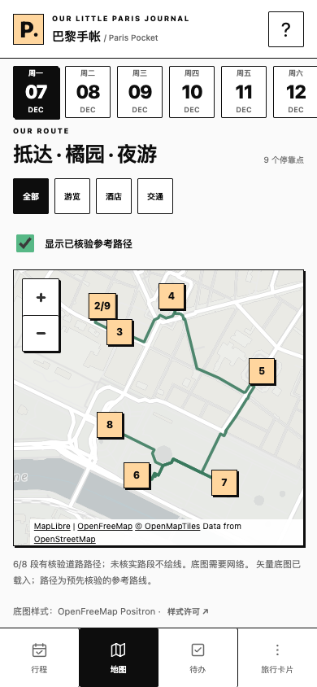
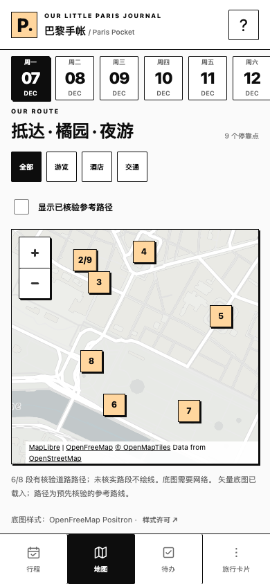
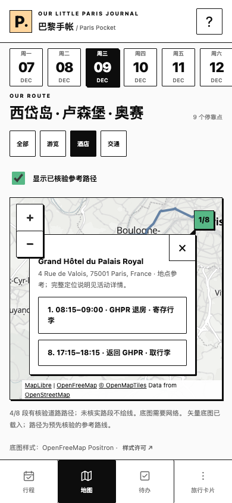
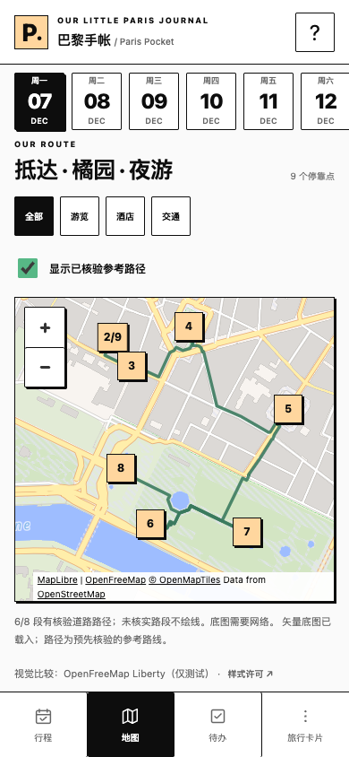

# Phase 3 — MapLibre / OpenFreeMap 地图评审

本轮仅替换新版主界面的地图渲染器与底图：**MapLibre GL JS 6.17.0 + OpenFreeMap Positron**。继续 `feature/paris-pocket-v2-refactor` / 草稿 PR #2；保留 `[skip netlify]`。没有合并 main、部署、改 Netlify 设置或访问生产个人资料。用户要求的下一步是评审本候选，更新 HTTPS 预览须另批。

## 实现与范围

- 新增小型原生 `map-renderer.js`，在地图页按需加载精确固定的 ESM、CSS 与匹配 worker；其他页面和 SW 安装不请求 SDK、style 或瓦片。无需 React、构建框架、API key 或新 npm 运行时依赖。
- 默认 Positron。Liberty 仅由测试挂载参数覆盖以制作比较图，没有新增产品切换按钮。两者保持平面视图，移除 extrusion/terrain，零时长初始 fit/popup 调整。
- 以独立 GeoJSON FeatureCollection 投影已核验的 walking/driving 几何，保留 `[lng,lat]`、ID 与全部点。步行 `#39795d`、驾车 `#55769d`，显示/隐藏不改数据；筛选只改变可见 Stop 和对应路线。
- 按 placeId 合并同地标记，按官方 order 编号；GHPR 的早寄存/晚取包仍为两个 Stop，弹窗显示官方时间与活动名称，分别打开同一个共享详情组件。
- 自动视野包含可见标记与路径，给缩放控件和署名留白；弹窗必要时平移相机以完整显示，不修改任何地点坐标。详情和列表保留完整地址、定位语义、备注、To-do、Google Maps 当前地点与明确单段导航。
- WebGL 初始化/丢失、SDK/CSS/worker/style/瓦片网络故障有回退或明确的部分底图提示；停靠点列表、详情与 Google 链接独立于底图。只有未知航站楼等无坐标点的筛选不画假坐标，也不默认用巴黎市中心冒充。
- SW 完整 shell 增加本地 renderer helper，更新缓存版本；外部 SDK/worker/矢量底图不进入 CORE，不增加瓦片批量下载或离线预缓存。原离线文字、笔记、任务与备份机制不变。
- `legacy.html` 的旧编辑器及其隔离历史设计预览维持 Leaflet，保护兼容恢复入口；新版主地图不再加载 Leaflet。

## 数据不变量

48 Places、76 Stops、68 Segments、28 道路几何及所有稳定 ID/来源元数据逐字不变。官方快照 SHA256 仍为：

`af2dbb626d063926bf126dad2ae376d51738df7e34546b60b2748a2a7ef63708`

`trip/`、`personal-data.js`、`itinerary-data.js`、`local-store.js`、`map-links.js`、`legacy-app.js`、`legacy.html`、`visual-preview.js` 均无本轮修改。没有重新计算路线、地理编码、补直线或更改任何交通/预订决定。[40 个缺口审计](../ROUTE_GAP_AUDIT.md) 继续生效。

## 390px 手机截图

均为 390×844 CSS px，独立合成资料 profile；页面自然滚动至日期与完整地图区域，保留来源署名。没有对截图做像素修改。

| 默认 Positron / 路线显示 | Positron / 路线隐藏 |
| --- | --- |
|  |  |
| GHPR 早寄存 / 晚取包 | Liberty 视觉比较（非产品默认） |
|  |  |

[离线回退截图](screenshots/offline-fallback-390.png) · [实际浏览器结果与四宽布局 JSON](screenshots/acceptance-results.json)

布局已检查 320/375/390/430px，无页面或地图水平溢出，主要控件和标记≥44px，底部导航/safe-area 沿用原实现。未重新设计行程、详情、To-do 或旅行卡片。

## 测试结果与边界

| 检查 | 实际结果 |
| --- | --- |
| Node | **61/61 PASS**，含冻结官方数据后精确几何投影、过滤排除、同地 ID/坐标不变的3项新增回归 |
| 原8套浏览器回归 | browser、management、visual、pwa、store-browser、integrated、concurrency、failure-ui 均 PASS；整合测试只转换 renderer DOM 断言，历史 Phase 3 截图不被覆盖 |
| Chrome 地图专项 | 实际 MapLibre WebGL2 + Positron，精确 GeoJSON/两种颜色、路线开关、visit/hotel/transport 筛选、重复访问及详情、快速切8天、四宽、归属链接、私有资料不变：PASS |
| 地图故障 | 无 WebGL、context lost、SDK/CSS/worker/style/矢量瓦片失败、离线冷启动：提示与停靠点/详情/Google 导航保留，Chrome PASS；离线备注、To-do 仍可用 |
| Liberty | 实际请求 Liberty，以测试 mount 覆盖；产品默认仍 Positron，无3D/terrain：PASS |
| WebKit 26.5 渲染 | Playwright 官方 WebKit 引擎，实际 Positron 与两天 GeoJSON 渲染：PASS；不是物理 iPhone |
| WebKit 模拟离线导航 | **未验证通过**：控制器已生效且 index/helper/bootstrap 缓存完整，`setOffline(true)` 后 reload 和新页面导航均返回 WebKit internal error。升级前 `a4abd91`（Leaflet）在独立临时 server/profile 同样复现。仅说明本环境无法完成此项，不证明真实 Safari 离线通过或失败 |
| 产物/一致性 | 明确白名单构建包含 renderer，保留全部 immutable releases；官方历史检查及 `git diff --check` 通过。未把地图依赖加入 SW 的外部预缓存 |

专项 CLI 的成功退出指必要 renderer 检查通过；JSON 用 `requiredRendererChecksPassed`，WebKit offline 单独标 `not-verified`，不会把完整 iPhone/PWA 验收写成通过。测试 profile/备份都是合成资料，未清理或读取正式站点存储。

复现（server 4178 已运行时）：

```sh
npm ci
npx playwright install chromium webkit
npm test
TEST_URL=http://localhost:4178 npm run test:map
TEST_URL=http://localhost:4178 npm run test:integrated
npm run check:releases
npm run build:site
```

使用本机 Chrome 可加 `PW_CHANNEL=chrome`。测试用 SwiftShader 明确启用隔离 headless WebGL2，不更改用户浏览器或生产保护。WebKit 默认使用 Playwright 安装路径，支持 `PLAYWRIGHT_BROWSERS_PATH` 或显式 `PW_WEBKIT_EXECUTABLE_PATH`；缺失时报告未测试而非假成功。此环境 WebKit 安装在临时目录，未添加项目依赖。Node 本机版本与引擎版本见 JSON；GitHub PR workflow 继续用 Node22 验证纯数据/产物。

## 修改文件与依赖

- `map-renderer.js`：SDK 按需加载、图层/标记/弹窗、生命周期、故障处理及纯投影助手。
- `app.js` / `index.html`：主地图接入，其他数据/表单逻辑不变；AppVersion `2.0.0-phase3-map`。
- `styles.css`：仅主地图控件、popup、marker 与署名样式；旧页面 CSS 保留。
- `sw.js` / `scripts/build-site.cjs`：helper 进入离线 shell/公开白名单，cache v7-maplibre。
- `package.json` / lock：版本号和 test:map 命令；npm 依赖集合未新增。
- `tests/map-renderer.test.cjs` / `tests/map-renderer.cjs` / `tests/integrated.cjs`：新增专项及适配现有回归。
- AGENTS/产品/README 与本报告、许可核查、截图：授权、当前状态和验收记录。

MapLibre 外部 ESM/CSS/worker 精确固定 **6.17.0**；约 1.62MiB 未压缩合计，不含瓦片/字体。它的冷加载和 WebGL 内存开销高于旧 Leaflet SDK，不能把视觉更轻误称为下载字节减少。按需加载、无 antialias、低功耗偏好、销毁旧 map 和空坐标筛选回退控制成本；真机性能仍待验收。

## 许可与剩余评审

[最新来源、许可及浏览器核查](../MAP_RENDERER_LICENSES.md)：MapLibre BSD-3-Clause；保留 OpenFreeMap/OpenMapTiles/OSM 角落链接与可访问样式许可。OSRM/FOSSGIS 路径来源另列，明确不是 OpenFreeMap 计算的路线。没有 API key、付费服务、运行时 geocoding/routing 或批量瓦片抓取。动态 ESM 的固定版本不等同整个模块图的 SRI；CSS 单独使用已核实 SRI，生产 CSP 未改。

仍需获批的独立 HTTPS 预览，在真实 iPhone Safari 和主屏幕 PWA 检查：WebGL2 初始化、连续切日与返回前台、弹窗/触控/键盘与内存、飞行模式冷启动、Google Maps handoff。WebKit 的模拟离线问题仍列为门槛，不能由 Chrome 结果代替。地图事实缺口维持原审计。

当前现有 Netlify 预览仍是旧渲染器的 fe21176；本轮截图是本地真实网络测试，不冒充新 HTTPS 预览。解除 `[skip netlify]`、更新预览、改发布设置或生产部署，均须用户另行批准。先停止本轮视觉/功能评审。
