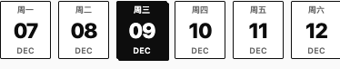
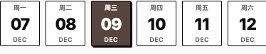
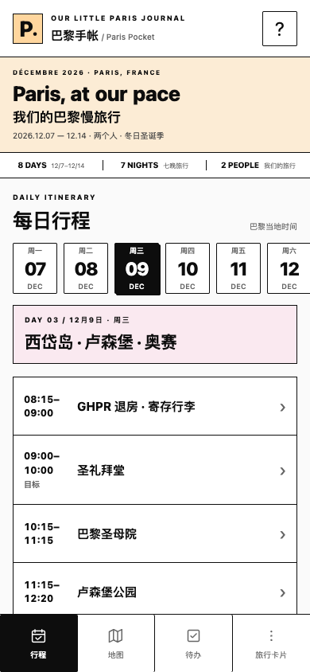
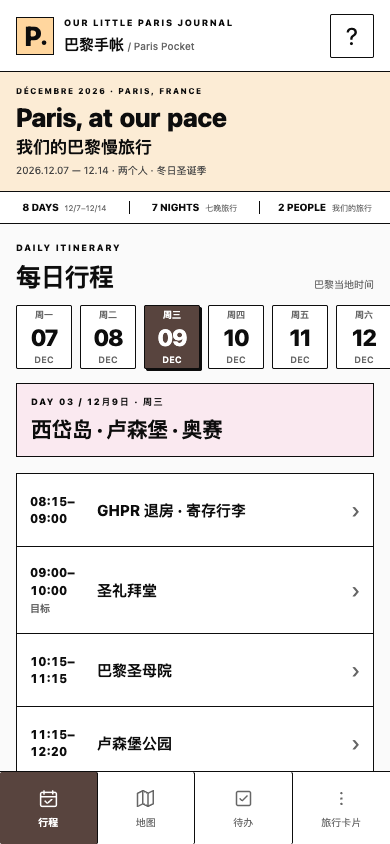
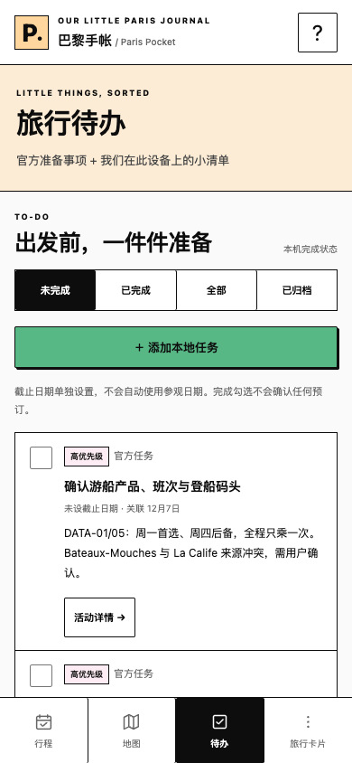
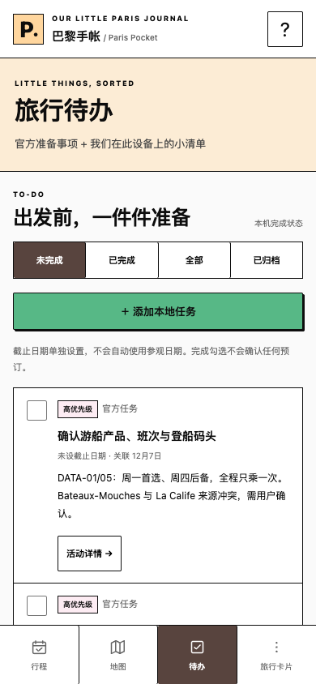
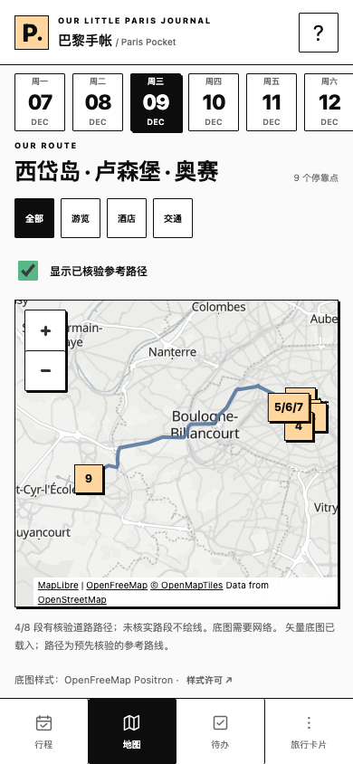
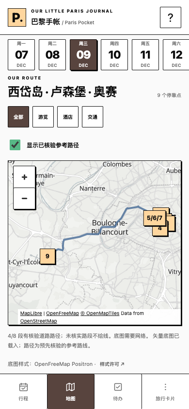

# Paris Pocket — 选中态颜色微调

2026-11-09，`feature/paris-pocket-v2-refactor` / [草稿 PR #2](https://github.com/jayven/Paris--traveler-note/pull/2)。保留已接受的 `7837a82` MapLibre 候选；本轮仅替换深色选中填充，等待视觉评审。未合并 main、未部署、未修改 Netlify 设置或接触生产个人资料。

统一使用 `--selected-bg:#58443e` / `--selected-text:#fff`。白字对比度 **9.09:1**，图标继承白色 `currentColor`。使用用户建议值；本轮可访问附件没有 P3 图片，不将 `D7FF28` 当成棕色，也不声称已采样匹配。详见 [UI Style Spec §8](../../references/UI_STYLE_SPEC_v1.1.md#8-selected-state-color-refinement--2026-11-09)。

## 390px 黑色／棕色对照

全部来自隔离 Chrome iPhone 参数 profile，390×844 CSS px、1× 像素比；控件图片是同一页面的原生截图裁剪。真实 v4.12 内容，非设计图。不是 Safari 真机截图。

| 原黑色 | 新棕色 |
| --- | --- |
| **底部导航（390px 宽裁剪）**  | **底部导航**  |
| **选中行程日期（390px 宽裁剪）**  | **选中行程日期**  |
| **每日行程完整页面**  | **每日行程完整页面**  |
| **To-do 状态**  | **To-do 状态**  |
| **每日地图／筛选**  | **每日地图／筛选**  |

黑色基线先在未修改的 `7837a82` 实拍保存。重复测试通过仅覆盖 `--selected-bg:#0d0d0d` 重现旧状态；三张完整黑色截图与实拍基线逐字节一致，[基线 SHA 记录](screenshots/baseline-original.json) 可核对。新棕色截图没有测试覆盖。地图来自实际 MapLibre / OpenFreeMap Positron，未改图块、坐标、路线或文字。

隔离预览同样沿用 token：[日期／导航](screenshots/isolated-itinerary-after-390.png)、[To-do／绿色完成状态](screenshots/isolated-todo-after-390.png)。历史 PHASE 2 横幅仍明确标记；主界面未添加预览横幅。

## 改动范围

- `styles.css`：增加两个 token；七组选中态规则使用 token（主日期、旧地图筛选、主导航、隔离日期、隔离导航、共用 To-do tabs、主地图 filters），日期子文字同步白色。
- `sw.js`：仅缓存名从 `paris-pocket-v7-maplibre` 改为 `paris-pocket-v8-selected-brown`，让缓存中的 CSS 可通过既有手动 App 更新取得。安装、等待更新、草稿保护、激活与读取逻辑均未改。
- `tests/selected-state.cjs`、`package.json`：新增 `test:selected` 和可重复截图／样式／交互／数据保护断言。
- `docs/references/UI_STYLE_SPEC_v1.1.md`：记录选中 token、适用组件、色值来源与保留项；本评审包、截图、根 README 和 AGENTS 更新当前范围及入口。

`--ink`、黑色正文／细描边／硬阴影、桃粉薄荷底色、绿色按钮／勾选／地图定位、错误色及步行／驾车路线色保持原样。字号、间距、布局、四个底部导航与无竖线行程列表未变。MapLibre renderer、全部 `trip/` 文件、导航 URL、个人存储／同步／备份／预订逻辑无修改。

## 回归结果

| 检查 | 本轮结果 |
| --- | --- |
| `npm run test:selected` | PASS：320/375/390/430px × 主行程／To-do／实际地图共 12 布局，隔离日期／To-do 共 8 布局。零页面错误、零水平溢出；底部导航在视口内、主要控件高度 ≥44px。日期子文字与图标白色、黑色描边／阴影／正文及绿色语义保持；切日期、切任务状态、酒店筛选、活动详情可用 |
| 选中态资料保护 | PASS：官方 bootstrap、地图 GeoJSON 与交通色、个人记录、旧 raw 完全未变；隔离预览零存储写入／零 IDB 打开 |
| `npm test` | **61/61 PASS**：官方资料、旧资料兼容、Google Maps、路线投影、迁移／备份及发布保留 |
| `test:integrated` | PASS：备注、任务 CRUD／完成、备份导入撤销、离线、地图开关／筛选／重复 Stop／详情和四屏四宽 |
| `test:visual` | PASS：历史隔离预览四屏四宽、数据零写入、可选预览失败降级 |
| `test:browser` / `test:management` | PASS：旧编辑器／预约／笔记、备份、移动／排序／删除恢复、离线、多窗口与手机布局 |
| `test:store` / `test:concurrency` / `test:failure` | PASS：IDB、同步／回退、并发冲突、草稿和存储失败恢复 |
| `test:pwa` | PASS：真实旧 bundle → 新版 → 回退 → 新版，等待更新／草稿保护、完整离线 shell 与新旧资料保留 |
| `check:releases` / `build:site` / `git diff --check` | PASS：活动 hash 保持 `af2dbb626d063926bf126dad2ae376d51738df7e34546b60b2748a2a7ef63708`；23 个公开构建文件，保留不可变发布；无部署 |

[机器可读布局／状态报告](screenshots/regression-results.json)。专用测试环境为 Chrome 157.0.8103.40 + Playwright，地图使用 headless SwiftShader WebGL2。未重新生成官方数据或覆盖已接受的历史地图截图。

复现：先 `PORT=4178 npm start`，另开终端运行 `TEST_URL=http://localhost:4178 PW_CHANNEL=chrome npm run test:selected`；没有 Chrome 时按根 README 安装 Playwright Chromium 并省略 `PW_CHANNEL`。其他回归命令见根 README。

## 评审边界

真实 iPhone Safari、主屏幕 PWA、系统字体与色彩显示仍需 HTTPS 真机验收。既有地图缺口及 WebKit 模拟离线导航限制保持原记录；本轮不声称解决它们。未获新部署授权，现有 Netlify 预览仍是旧 `fe21176`，不能用它评审此棕色版本。

提交和 PR 标题继续保留 `[skip netlify]`，禁止自动触发新预览。此处交付仅供代码／截图评审；等待用户视觉批准，不合并、不部署、不改 Netlify 设置。
